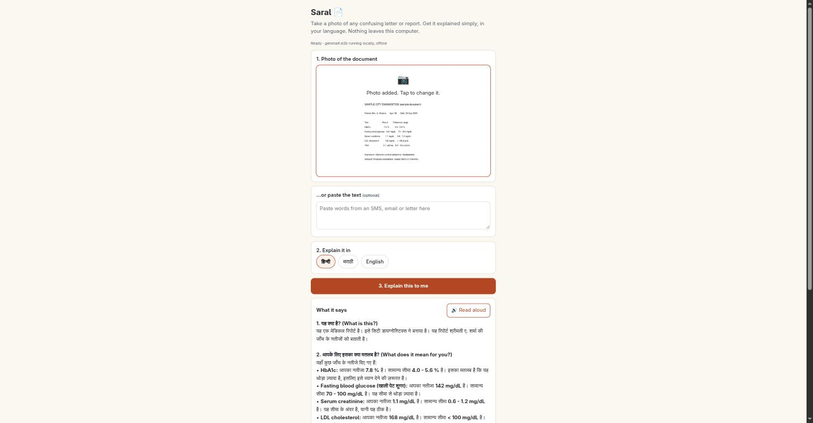
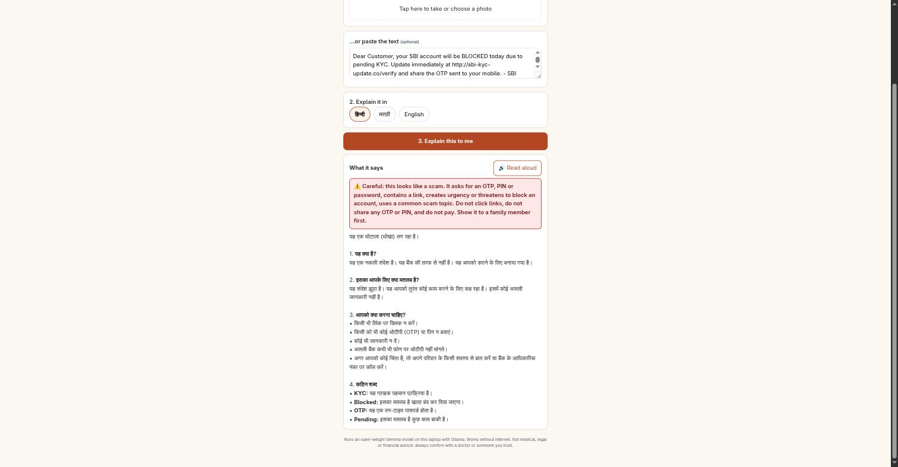

# Saral 📄

**Take a photo of a confusing letter or report. Get it explained simply, in Hindi, Marathi or English. Nothing leaves your computer.**

Saral (सरल, "simple") is for parents and grandparents who get medical reports, bank letters, bills and
government notices they can't fully read. It runs Google's open-weight **Gemma 4** model locally with
[Ollama](https://ollama.com), so private documents never go to a server, and it works with no internet.





## What it does

- 📷 Reads a **photo** of the document (Gemma 4 is multimodal) or pasted text from an SMS/email
- 🗣️ Answers in **हिन्दी, मराठी or English**, in four fixed sections: *What is this? · What does it mean for you? · What should you do? · Difficult words*
- 🔢 Quotes each result or amount next to its normal range or due amount, then says if it's fine or needs attention
- ⚠️ **Scam guard**: plain-code checks (OTP/PIN requests, links, "account blocked today", KYC/lottery/refund) run *before* the model and show a red warning, and force the answer to say *don't click, don't share, don't pay*
- 🔊 **Read aloud** with the browser's built-in voices, for readers who prefer listening

## Run it

```bash
# 1. Install Ollama (https://ollama.com/download) and pull the model (~4.6 GB)
ollama pull gemma4:e2b

# 2. Start Saral (Python 3.10+, no packages to install)
python3 server.py
# open http://127.0.0.1:8765
```

Tested on a laptop with a 6 GB GTX 1660 Ti: about 25 tokens/s, roughly a minute for a full explanation of a photographed report.

Settings (environment variables): `SARAL_MODEL` (default `gemma4:e2b`; `gemma4:e4b` is better if you have the memory),
`SARAL_OLLAMA_URL`, `SARAL_HOST`, `SARAL_PORT`.

## How it works

```
browser (static/index.html)  ──photo/text──▶  server.py  ──/api/chat──▶  Ollama + Gemma 4 (local)
         ▲                                        │
         └──────── streamed plain-language answer ┘   + X-Saral-Red-Flags header (scam checks)
```

- `server.py`: about 200 lines of Python standard library. Serves the page, runs the scam checks, builds the prompt, streams the answer.
- `static/index.html`: one file, no frameworks. Shrinks phone photos to 1600 px before sending, renders the answer safely, reads it aloud.

## Why the scam guard is in code

In testing, the small model explained a fake "SBI KYC" SMS in Marathi and then, in *What should you do?*, repeated the
scammer's instructions: open the link and share the OTP. A prompt line asking it to watch for scams wasn't enough.
Now simple regex checks flag the message first; when they fire, the UI shows a red banner and the prompt switches to strict
"do not click / do not share / do not pay" rules. The warning never depends on the model getting it right.

Limitation: the red-flag checks run on pasted text. For photos, the prompt still forbids following a document's instructions,
but there's no code-level check yet (an OCR pass would add one).

## Not advice

Saral explains documents; it doesn't diagnose, give legal or financial advice, or replace a doctor or bank. It tells readers to confirm
medical results with their doctor.

## License

MIT
